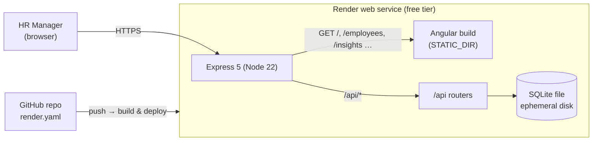
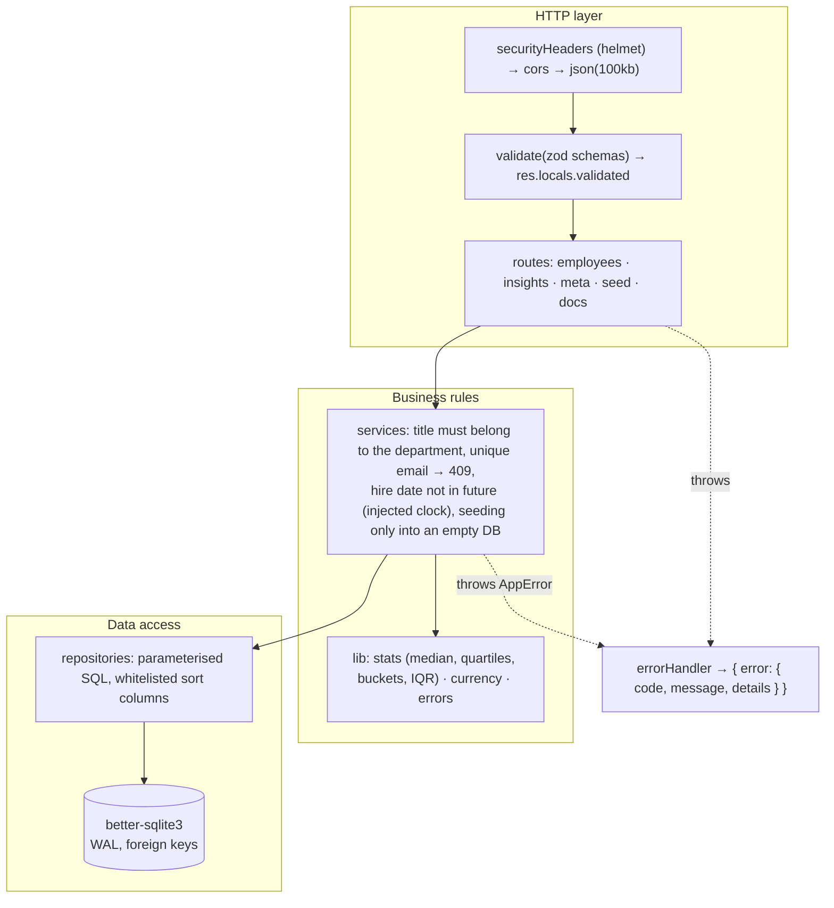
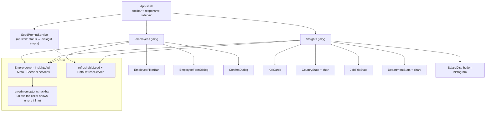
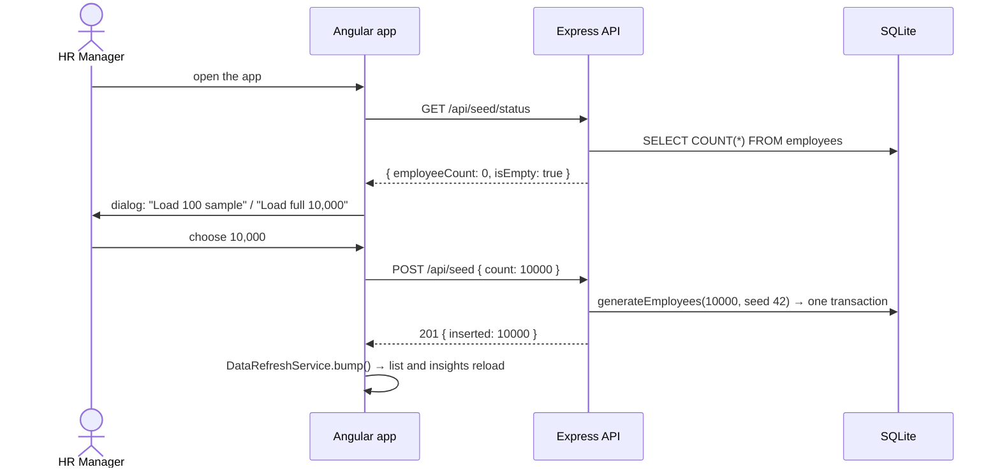
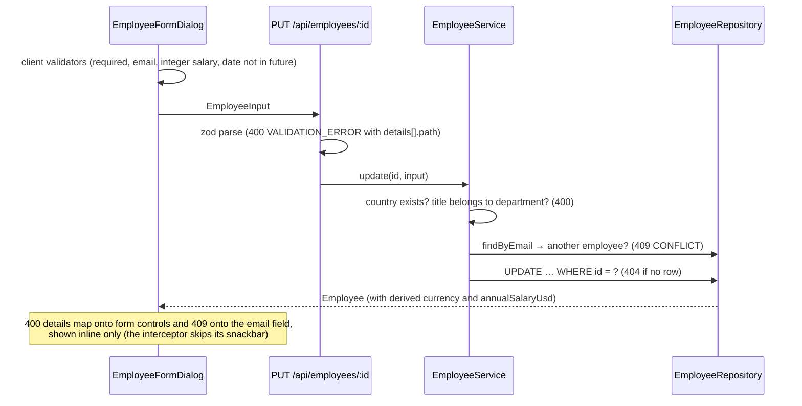
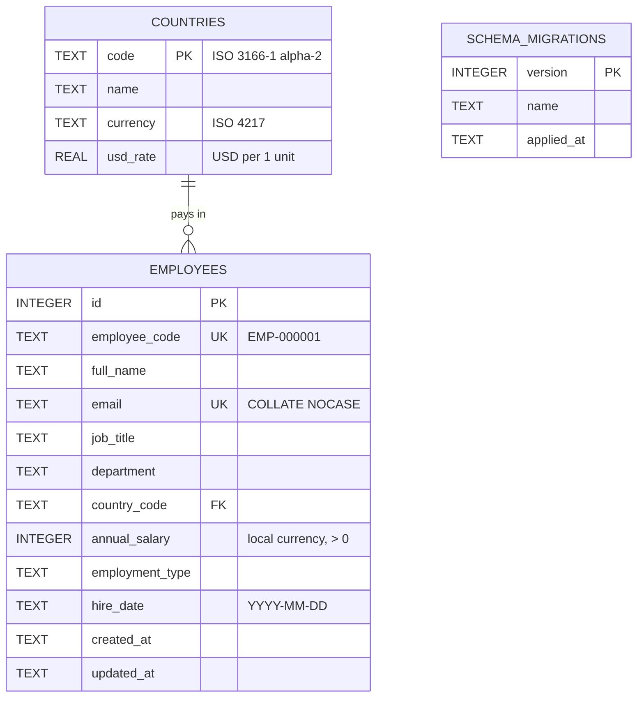

# Architecture

The diagrams are written in Mermaid, which GitHub renders inline.

## 1. System context and deployment
In production a single Node.js process serves both the REST API and the compiled Angular app. Locally the two run separately: `ng serve` on :4200 and the API on :3000, with CORS between them.

## 2. Backend layers
Each feature module has the same three layers. Every layer depends only on the one below it, and the database is injected through `createApp({ db })`, so tests use an in-memory database with no mocks.

The same zod schemas feed both request validation and the generated OpenAPI document (`/api/openapi.json`, with Swagger UI at `/api/docs`). The docs therefore can't drift from what the API actually accepts.

| Folder (`backend/src`) | Responsibility |
|---|---|
| `domain/reference.ts` | Countries, FX rates, departments, job titles. This is the single source of the reference data; migrations upsert the countries from it |
| `db/` | Connection (pragmas), schema, migration runner |
| `modules/employees` | CRUD, list/filter/sort/paginate, CSV export |
| `modules/insights` | Aggregations: summary, by-country, by-job-title, by-department, distribution |
| `modules/meta`, `modules/seed` | Dropdown reference data; seed status and trigger |
| `seed/` | PRNG, pure generator, transactional insert, CLI |
| `docs/` | OpenAPI registry and generator |
| `middleware/` | Validation, errors, 404, security headers, SPA serving |

## 3. Frontend structure

- **State:** signals and `computed`. Each list or insight section derives its request from signals, so a new request cancels the previous one (`switchMap`). The section also reloads whenever `DataRefreshService` changes, which happens after a seed, create, edit or delete.
- **Performance:**
  - Both feature routes are lazy-loaded.
  - Chart.js is provided only on the insights page, not app-wide, which keeps it out of the initial bundle.
  - All components use `OnPush`, and the app runs without zone.js.

## 4. Key request flows

### Start-up on an empty database (seed prompt)

### Editing an employee (validation round-trip)

## 5. Data model

Indexes: `(country_code, job_title)`, `(department)` and `(full_name)`. USD amounts are never stored. They are computed at query time as `annual_salary × usd_rate`, so updating a rate needs no data migration.
